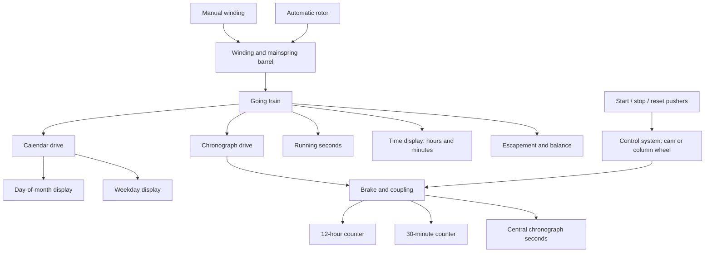

# C-01 Architecture Trade Study 01
**Status:** Preliminary engineering study — architecture not frozen  
**Revision:** 0.1  
**Branch:** `steward/c-01-movement-foundation`

## 1. Decision to make

C-01 must provide:
- Automatic winding, hand winding and hacking seconds
- Hours and minutes
- Weekday and day-of-month
- Central chronograph seconds
- 30-minute and 12-hour elapsed-time registers
- Running seconds
- A serviceable, durable mechanical platform

The central design question is not simply “column wheel or cam.” Chronograph control and chronograph coupling are separate subsystems and must be evaluated independently.

## 2. Evidence-based benchmark

### ETA 7750
ETA's official product page specifies an integrated, cam-controlled, two-pusher automatic chronograph with day and date, central chronograph seconds, 30-minute and 12-hour counters, 4 Hz, 30.00 mm diameter, 7.90 mm height, 25 jewels and 54-hour typical reserve.

Source: https://portal.eta.ch/en/7750-7750-5.html

### Sellita SW500 a
Sellita's official 2019 catalogue identifies the SW500 a as the day-date version: integrated cam-operated automatic chronograph, two pushers, central 60-second counter, 30-minute counter at 12, 12-hour counter at 6, quick-set day/date, 4 Hz, 30.00 mm diameter, 7.90 mm height and 25 jewels. That catalogue states 48 hours running time.

Source: https://www.sellita.ch/images/documents/Catalogue2019_ENG.pdf (SW500 family, printed pages 36–39)

**Reserve-data control:** Other catalogue editions and secondary technical summaries may state different SW500 reserve figures. Until the current official SW500 a technical sheet is obtained and revision-checked, C-01 must not treat 62 hours as a confirmed SW500 a benchmark. Record source edition alongside every benchmark number.

## 3. Separate the two architecture decisions

### A. Chronograph control: cam vs column wheel

| Criterion | Cam control | Column wheel |
|---|---|---|
| Function | Sequences start, stop and reset levers | Same |
| Manufacturing | Generally simpler geometry and lower-cost production | More precision machining and finishing |
| Adjustment | Often designed for repeatable, standardized assembly | Lever-to-column interaction may need careful fitting |
| User feel | Depends on cam profile, lever geometry and spring forces | Often capable of a crisp, defined pusher action |
| Serviceability | Strong candidate for standardized, repeatable service | Can be excellent, but more sensitive to exact component fit |
| C-01 status | Preferred baseline for evaluation | Retain as an alternative |

This is a provisional preference, not a final selection. Pusher force, travel, wear and reset behavior must be measured on physical examples.

### B. Chronograph coupling: horizontal vs vertical

| Criterion | Horizontal / lateral coupling | Vertical clutch |
|---|---|---|
| Engagement | Intermediate toothed wheel moves into mesh | Friction surfaces engage on a common axis |
| Start behavior | Tooth phase can produce a small start jump | Friction engagement can provide a cleaner start |
| Layout | Can be visually accessible and mechanically legible | Often compact around the central axis but can be buried under bridges |
| Running load | Engagement adds a coupled gear train; amplitude impact must be measured | Can reduce engagement disturbance; continuous-running load still needs measurement |
| Service | Familiar conventional wheel/lever system | Clutch friction surfaces, endshake and adjustment require attention |
| C-01 status | Evaluate as baseline | Evaluate if measured performance justifies complexity |

A vertical clutch does not automatically mean column-wheel control. The two decisions must not be conflated.

## 4. Integrated vs modular

**Integrated:** chronograph components are designed into the movement architecture. Advantages to investigate: coherent packaging, direct access to the chronograph train, and a single integrated platform. Risks: more original engineering, tooling and validation.

**Modular:** a chronograph module is mounted to a separate base movement. Advantages to investigate: reuse of a proven timekeeping base and potentially faster development. Risks: stack height, added interfaces, hand-height constraints, service complexity and dial-layout constraints.

**Preliminary direction:** develop C-01 as an integrated architecture study first, because the requested day-date and chronograph display are central to the product rather than optional add-ons. Do not freeze this choice until a packaging and cost study is complete.

## 5. First-pass functional architecture

This is a functional block diagram, not a detailed gear-train drawing. It intentionally contains no invented tooth counts, torque values, gear ratios, spring dimensions or clearances.

## 6. C-01 preliminary engineering position

1. Keep the 4 Hz target as the baseline because both principal day-date benchmarks use it.
2. Use the ETA 7750 and Sellita SW500 a as functional benchmarks, not as a claim that C-01 has equivalent performance.
3. Carry cam control forward as the first architecture to study for serviceability and manufacturing repeatability.
4. Compare horizontal and vertical coupling through measured amplitude, start-hand behavior, power consumption, wear and service procedure.
5. Keep integrated architecture as the leading design study, but do not freeze it.
6. Treat 60–70 hours as a design target requiring a real energy budget; it is not yet demonstrated.
7. Keep weekday and day-of-month as explicit user-facing requirements. Calendar safety, quick-set behavior, midnight changeover and setting instructions require their own design and test work.

## 7. Required next evidence

- Current official ETA 7750 technical drawing and service documentation, with document revision.
- Current official Sellita SW500 a technical drawing and service documentation, with document revision.
- Confirmed current reserve specification for the exact SW500 a revision being benchmarked.
- Teardown photographs and a component/function map from a lawfully obtained reference movement.
- Measured pusher force/travel, chronograph start behavior, amplitude in each operating state, reserve with chronograph off/on, and calendar changeover behavior.
- Packaging envelope including dial-side hand heights, calendar discs, rotor clearance, caseback clearance and pushers.

## 8. Sources

- ETA 7750 official specification: https://portal.eta.ch/en/7750-7750-5.html
- Sellita official catalogue 2019, SW500 family: https://www.sellita.ch/images/documents/Catalogue2019_ENG.pdf
- Sellita SW5XX technical-document portal: https://www.sellita.ch/scripts/calibres/sc218-generator-cald.php?calid=75&sc218Lng=en
- American Watchmakers-Clockmakers Institute, chronograph technical handouts: https://www.awci.com/wp-content/uploads/2020/06/Chronograph-Documents.pdf
- American Watchmakers-Clockmakers Institute, vertical clutch technical note: https://www.awci.com/wp-content/uploads/2020/11/HT_December_2020-Members_Only-1.pdf

---
**Engineering integrity note:** No prototype has been manufactured. No performance target in this document has been validated by physical testing. This study records design reasoning and the evidence still required.
