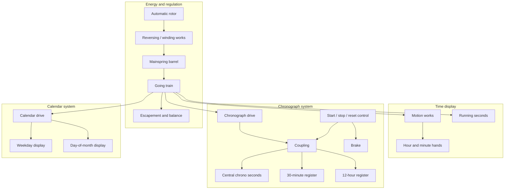

# C-01 Mechanical Layout and Packaging Study 01
**Status:** Concept layout — not a production drawing  
**Revision:** 0.1  
**Branch:** `steward/c-01-movement-foundation`

## 1. Purpose

Translate the C-01 functional requirements into a physical packaging plan and identify the measurements required before detailed CAD.

This document defines interfaces and design zones. It does not claim that the movement has been dimensioned, modeled, prototyped or validated.

## 2. Functional stack

The movement is divided into four physical/functional zones:

1. **Energy and regulation:** rotor, automatic winding works, mainspring barrel, going train, escapement and balance.
2. **Time display:** motion works, hour/minute display and running seconds.
3. **Chronograph:** drive, control, coupling, brake and elapsed-time counters.
4. **Calendar:** weekday and day-of-month discs, driving components, jumper/indexing components and correctors.

The final plate/bridge topology must be determined by access, stiffness, assembly order, serviceability and actual component geometry.

## 3. Preliminary packaging reference

The ETA 7750 official product specification gives a 30.00 mm movement diameter and 7.90 mm movement height. These are useful reference dimensions for a proven day-date automatic chronograph, not dimensions that C-01 is required to copy.

Reference: https://portal.eta.ch/en/7750-7750-5.html

**C-01 envelope status: OPEN.** No target diameter or height is frozen. The first CAD envelope should be derived from:
- Intended case diameter and internal case geometry
- Desired dial opening and subdial positions
- Hand stack and calendar-disc clearances
- Rotor sweep and caseback clearance
- Crown, pusher and stem locations
- Movement casing supports and anti-rotation features
- Shock protection and balance access
- Service access to calendar and chronograph components

## 4. System relationship diagram

This is a power and function relationship, not a literal component-location map. The exact drive take-offs and gear interfaces are still to be designed.

## 5. Layout zones to investigate

### Dial side
Candidate functions:
- Calendar discs and their indexing/jumper elements
- Motion works and hand-setting interfaces
- Dial-side chronograph components if required by the chosen architecture
- Hand-height and dial clearance management

Open questions:
- Can weekday and date be displayed legibly without compromising subdial size?
- Are both calendar displays driven from one calendar program wheel or separate indexing stages?
- Can the calendar be serviced without disturbing the chronograph?
- What is the required clearance between discs, dial, hands and bridges?

### Bridge / movement side
Candidate functions:
- Barrel and going train
- Escapement and balance
- Automatic winding works and rotor
- Chronograph control, coupling and counter drive
- Structural bridges and service access

Open questions:
- Is the chronograph train accessible without removing the automatic winding system?
- Can the balance and escapement be serviced independently?
- Does the rotor obscure chronograph adjustment points?
- What bridge arrangement provides stiffness without making routine service unnecessarily difficult?

## 6. Calendar behavior and setting safety

C-01 requires a weekday and day-of-month display. The mechanism must be designed and tested for:
- Correct weekday progression and correct date progression
- Month-end handling for 28-, 29-, 30- and 31-day months
- User correction after short months
- Clear distinction between safe and unsafe quick-setting periods
- No calendar corrector engagement while the calendar train is under damaging load
- Reliable midnight changeover
- Correct behavior when hands are positioned around the changeover interval
- Clear, durable setting instructions

**Important:** A simple 1–31 date mechanism does not know the length of each month. Unless a month-length mechanism is deliberately added, the user must manually advance the date after shorter months. Leap-year logic is not required for the stated day-of-month display.

The exact safe-setting window must be derived from the final calendar geometry and documented in the user manual. Do not publish a generic safe window before the mechanism is designed and tested.

## 7. Chronograph interaction and load cases

The chronograph must be evaluated in at least these states:
1. Chronograph stopped
2. Chronograph running
3. Chronograph stopped after elapsed-time measurement
4. Chronograph reset
5. Start and stop actuation during low mainspring torque
6. Repeated start-stop-reset cycles
7. Chronograph running during automatic winding

Measure:
- Timekeeping rate and balance amplitude in each state
- Power/reserve with chronograph stopped and running
- Start-hand jump or delay
- Reset alignment and repeatability
- Pusher force and travel
- Wear and adjustment drift over repeated cycles

No numerical acceptance thresholds are set here because C-01's actual train, escapement, spring and coupling loads are not yet known.

## 8. Dimensional control register

| Dimension / interface | Status | Required evidence |
|---|---|---|
| Overall movement diameter | Open | Case and dial packaging study |
| Overall movement height | Open | Full stack-up and caseback clearance |
| Barrel diameter / height | Open | Torque curve, energy budget and available area |
| Gear center distances | Open | Train ratio and CAD layout |
| Gear tooth counts / modules | Open | Frequency, ratios, geometry and manufacturability |
| Balance diameter / inertia | Open | Oscillator design and energy analysis |
| Rotor diameter / mass / bearing | Open | Winding performance and case geometry |
| Calendar disc diameter / thickness | Open | Dial opening and hand clearance |
| Hand heights | Open | Dial, crystal and counter layout |
| Pusher/stem coordinates | Open | Case design and actuation geometry |
| Bridge thickness / screw positions | Open | Structural and service studies |

## 9. Prototype path

### Stage A — Reference movement study
Acquire a lawfully sourced reference movement or manufacturer-authorized technical sample. Photograph and document it before disassembly. Record movement identification and document revision.

### Stage B — Functional teardown
Map every component to a subsystem. Record interfaces, spring directions, pivots, jewels, endshake/shake, lubrication points and assembly dependencies. Do not assume the reference architecture will be copied.

### Stage C — Parametric CAD skeleton
Create only the datum planes, envelope, shaft axes, dial coordinates, pusher/stem axes and reserved component zones. Label all unmeasured dimensions as provisional.

### Stage D — First mechanism prototypes
Prototype calendar indexing and chronograph control separately before attempting a complete movement. Evaluate force, repeatability, wear, reset alignment and service procedure.

### Stage E — Integrated alpha movement
Only after subsystem tests, integrate the barrel/going train, regulation, calendar and chronograph. Run instrumented tests for rate, amplitude, reserve, shock and actuation.

## 10. Engineering release gates

Do not advance to a production-intent design until:
- Functional architecture is selected and documented
- Dimensioned drawings exist for every critical interface
- Energy budget uses measured barrel torque and validated efficiency estimates
- Calendar safety and month-end behavior are tested
- Chronograph coupling and control pass repeatability tests
- Service procedures and lubrication specifications exist
- Materials, tolerances and manufacturing processes are specified
- Independent watchmaking review is complete

## 11. Open decisions

- Integrated vs modular construction
- Cam vs column-wheel control
- Horizontal vs vertical clutch
- Movement envelope and case size
- Calendar display arrangement and corrector locations
- Counter positions and running-seconds position
- Frequency confirmation and oscillator selection
- Reserve target after measured power budget

---
**Engineering integrity note:** This is a functional packaging study. It is not a dimensioned mechanical drawing, CAD model, manufacturing specification or validated prototype.
